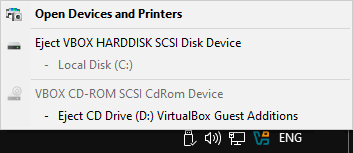
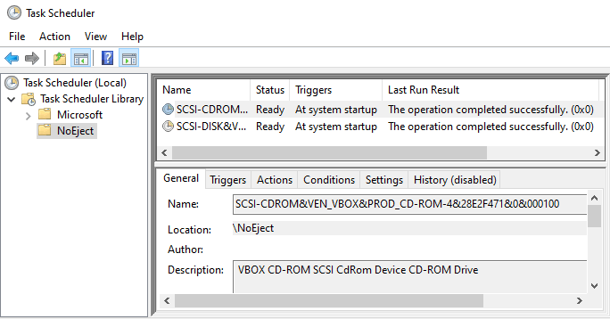

# NoEject

Hide items from the taskbar *Safely Remove Hardware And Eject Media* menu. For Windows Vista and later.

From this



To this


Tasks per device are added in **Task Scheduler** NoEject sub-folder.
If you don't need them any more, remove manually.



## Usage

```
noeject.exe /?

NoEject 1.0.0 (0BSD License) Hide devices from the eject menu.
    -[?|h]              Show this help.
    -s                  Save the hiding.
Typical usage steps:
    noeject.exe         1. List removable devices.
    noeject.exe -s      2. Hide removable devices.
Unhide:
    Use Task Scheduler, delete tasks in NoEject sub-folder.
Tips:
    If the device is not listed, but showing in the eject menu,
    eject the device but don't unplug, then re-run noeject.
```

## Is it safe?

I believe so. A scheduled task first check if the device of interest exists. 
If it exists, check whether it has the original removal capabilities. 
Only if all things are right, change the device capabilities to non-removable.

So if the device driver is removed, the registry remains intact. No harm should be done.

## Development

VS2026 solution are provided to ease the development. It links to UCRT.

If compile using nmake makefile, the binaries link to the classic msvcrt.dll.

## License

Zero-Clause BSD
